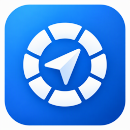

# Azure CasePilot



快速创建和管理 Azure Support Case: 原生 Mac App、服务器 / AKS 部署与 MCP。

## 下载安装 (推荐)
1. 到 [Releases](https://github.com/ZenoRewn/Azure_CasePilot/releases/latest) 下载 `CasePilot-*-macOS-universal.zip` 并解压
2. **首次打开前必须执行一次** (App 未经 Apple 公证, 否则会提示"已损坏"或"无法验证开发者"):
   ```bash
   xattr -dr com.apple.quarantine ~/Downloads/CasePilot.app   # 按实际路径修改
   ```
3. 双击 `CasePilot.app`

要求 macOS 14+, Universal (Apple Silicon + Intel), 约 1.2MB。关闭窗口或 ⌘Q 即完全退出, 无后台服务。

## 登录
| 方式 | 前提 | 说明 |
|---|---|---|
| Azure CLI (默认, 自动尝试) | 已 `az login` | 复用本机 CLI 会话 |
| 浏览器登录 (设备码) | 无 | 在浏览器输入验证码, 支持 MFA |
| App Registration | Client ID + Secret | 需在订阅上授予 **Support Request Contributor** 与 **Reader**; Tenant/Client ID 存本机, Secret 存钥匙串, 下次自动填充 |

点击左下角**身份卡**可随时切换 租户 / 订阅 (含租户级) / 认证方式。

## 功能
- **AI 帮写** (v2.0): 一句话描述 (可语音) → AI 选择服务 / 问题类型 / 严重性并写好结构化描述; 信息不足时追问一轮。只从 Azure 真实目录中选择, 不编造。默认 westus3 `gpt-6-luna`, 可在侧边栏「设置 → AI 与语音」或 AI 帮写旁的模型按钮修改 Endpoint / 部署 / **API Key** (Key 存钥匙串; 留空则用登录身份, 需 Cognitive Services OpenAI User 角色)
- **语音输入** (v2.0): 新建描述与补充信息均可录音转写, 支持 Azure OpenAI (`gpt-4o-mini-transcribe`) 或 Azure Speech (可填 **区域 + Speech Key**)
- **支持计划**: 侧边栏显示 (如 Unified / ProDirect / Standard), 来源标注 (最近 Case 或订阅类型推断; Azure 无公开查询 API); 不支持 A/A+ 时提示
- **新建 Case**: 选服务 → 问题类型 → 严重性 (C/B/A/A+) → 标题与描述 → 提交 (⌘↩)
  - 快捷入口: 配额申请、计费/订阅、Azure OpenAI、Microsoft Foundry 及最近使用的服务
  - 「最近使用」: 提交过的 服务 + 问题类型 一键复用
  - 从订阅资源反查服务; 结构化描述模板; 请求体预览
  - 「更多选项」: 关联资源、开始时间、24×7、诊断授权
  - Compute vCPU 配额结构化表单
- **联系人**: 在 设置 (⌘,) 中维护, 默认 简体中文 / 中国 / China Standard Time
- **我的 Case**: 统计、搜索、状态与时间筛选; 详情 (属性、SLA、描述、沟通记录); 补充信息; 关闭 Case (回读确认)
- **支持计划提示**: 根据该订阅最近 Case 推断

## 从源码构建
```bash
cd macos
swift test                    # 单元测试
./build_app.sh v2.2.0         # 产物: dist/CasePilot-v2.2.0-macOS-universal.zip
```

## MCP (Claude Desktop / VS Code / Copilot 等)
工具: `list_services` `list_problem_types` `draft_case` `create_case` `list_cases` `get_case` `add_case_message` `close_case` `get_support_plan`。写操作必须 `confirm=true`。
- **本机 (stdio, 复用 az login)**:
  ```json
  {"mcpServers": {"casepilot": {"command": "python3", "args": ["-m", "casepilot.mcp"], "cwd": "<仓库路径>",
    "env": {"CASEPILOT_SUBSCRIPTION_ID": "<订阅>"}}}}
  ```
  App 内 设置 → MCP 可一键复制。
- **服务器 (HTTP)**: `POST https://<host>/mcp`, `Authorization: Bearer <CASEPILOT_API_KEY>`

## 服务器 / AKS 部署
零依赖 Python 容器 (`Dockerfile`) + Helm (`deploy/helm/casepilot`), 使用 **AKS Workload Identity**, 无需任何密钥访问 Azure:
```bash
RG=<rg> AKS=<aks> ACR=<acr> SUB=<订阅> AOAI=<AI 资源名> ./deploy/aks.sh
```
脚本会: ACR 构建镜像 → 创建托管标识与联邦凭据 → 授予 Support Request Contributor / Reader / Cognitive Services OpenAI User → 生成 API Key → helm 安装。
服务器模式下 AI/Speech Key 只从环境变量或 K8s Secret 读取 (`CASEPILOT_AOAI_KEY` / `CASEPILOT_STT_KEY` / `CASEPILOT_SPEECH_REGION`, Helm `casepilot.ai.keysSecret`), 不接受浏览器传入; 所有 API 与 /mcp 需 Bearer API Key; 也可置于 Entra 认证网关后 (`trustProxyAuth`)。非 K8s 服务器: `CASEPILOT_MODE=server CASEPILOT_API_KEY=... AZURE_TENANT_ID/CLIENT_ID/CLIENT_SECRET=... python3 server.py`。

## Web 版 (备选, 跨平台)
仓库根目录的 `server.py` + `static/` 为早期 Web 版 (仅需 Python 3.9+, 零依赖):
macOS 双击 `start.command`, Windows 双击 `start.bat`, 浏览器自动打开 http://127.0.0.1:8765 。
服务端测试: `python3 -m unittest discover -s tests`。

## 已知限制 / 待办
- **云环境**: 原生 App 仅支持 Azure Global。
- **Windows**: 原生 App 仅 macOS; Web 版 `start.bat` **尚未在 Windows 上实测**。
- **签名公证**: 目前为 ad-hoc 签名, 首次需执行 `xattr`。免除此步需 Apple Developer Program 的 "Developer ID Application" 证书 + `notarytool` 公证。
- **浏览器登录**: 需人工输入验证码, 尚未完整人工验证。
- **AI 配额**: 默认部署 TPM 较低 (10K), 并发多时会 429 (已自动退避重试); 生产建议提高配额或换部署。

## 安全
凭据仅在本机 (内存 / 钥匙串), App 直接调用 Azure ARM `Microsoft.Support` API (2024-04-01), 不经过任何第三方服务。
