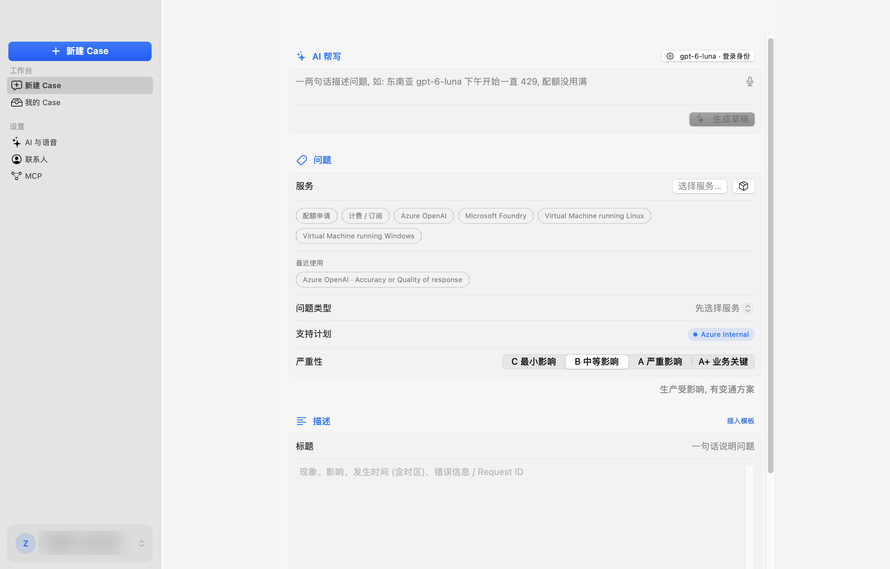
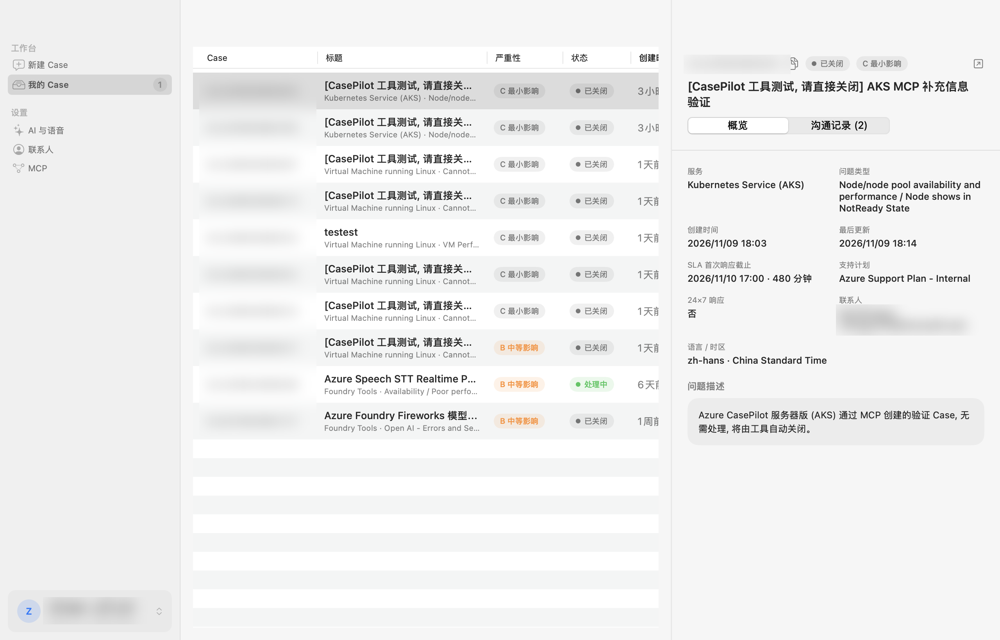

# Azure CasePilot


一句话描述问题, 快速创建和管理 Azure Support Case。提供 macOS / Windows 原生 App、跨平台 Web 版、MCP 与 AKS 部署。

<p>
  
  
</p>

## 快速开始

| 平台 | 下载 ([最新 Release](https://github.com/ZenoRewn/Azure_CasePilot/releases/latest)) | 首次运行 |
|---|---|---|
| macOS 14+ (Universal) | `CasePilot-*-macOS-universal.zip` | 未经公证, 先执行 `xattr -dr com.apple.quarantine CasePilot.app`, 再双击 |
| Windows x64 / ARM64 | `CasePilot-*-win-x64.zip` / `win-arm64.zip` | 解压双击 `CasePilot.exe` (自包含); SmartScreen 点「更多信息 → 仍要运行」 |
| Linux / 其他 (Web 版) | `CasePilot-*-linux.tar.gz` | 解压后 `./start.sh` (Python 3.9+), 浏览器打开 http://127.0.0.1:8765 |
| 团队共享 (AKS) | 见下方 [一句话部署](#一句话部署到-aks) | — |

关闭窗口即完全退出, 无后台服务。

## 登录与权限

| 方式 | 前提 |
|---|---|
| Azure CLI (默认, 自动尝试) | 本机已 `az login` |
| 浏览器登录 (设备码) | 无, 支持 MFA |
| App Registration | Client ID + Secret (Secret 存钥匙串 / 凭据管理器) |

所需角色: 订阅上 **Support Request Contributor** + **Reader**; 使用 AI 时, AI 资源上 **Cognitive Services OpenAI User** (Speech 为 **Cognitive Services User**)。
点击左下角**身份卡**随时切换 租户 / 订阅 (含租户级) / 认证方式。

## 功能

### 新建 Case
- 侧边栏顶部 **「新建 Case」** 主按钮 (⌘N / Ctrl+N); 提交 ⌘↩ / Ctrl+Enter, 提交前确认
- **AI 帮写**: 一句话 (可语音) → 自动选服务、问题类型、严重性, 并写好结构化描述 (现象 / 影响 / 时间 / 错误 / 已尝试); 信息不足时追问一轮。只从 Azure 真实目录中选择, 不编造
- 快捷入口: 配额申请、计费 / 订阅、Azure OpenAI、Microsoft Foundry; 「最近使用」一键复用服务 + 问题类型; 从订阅资源反查服务
- **支持计划徽章**: 显示当前订阅的支持计划 (如 Unified / ProDirect / Standard); 所选 A / A+ 可能不被支持时变橙色提醒
  > Azure 没有公开 API 查询支持计划, 按该订阅最近一年的 Case 或订阅类型推断; 租户级或无历史 Case 时显示「未知」
- 更多选项: 关联资源、开始时间、24×7、诊断授权; Compute vCPU 配额结构化表单; 请求体预览

### 流式语音输入
边说边出字, 用于新建描述、AI 追问与 Case 回复, 三端一致:
- **Azure OpenAI Realtime `gpt-live-transcribe`** (默认)
- **Azure Speech 实时识别 + Post-Stream Refinement (PSR)**: 说话时快速出中间结果, 每句结束替换为二次识别的更准确文本
- 直接走 WebSocket 协议, 不引入 Speech SDK; 流式失败时自动退回整段转写 (`gpt-4o-mini-transcribe` / Speech 快速转写)

### 我的 Case
统计、搜索、状态与时间筛选; 详情 (属性、SLA、描述、沟通记录); 补充信息 (可语音); 关闭 Case (回读确认)。

### AI 与语音设置
侧边栏「设置 → AI 与语音」, 或 AI 帮写旁的模型按钮:

| 项 | 默认 |
|---|---|
| 对话 Endpoint / 部署 | westus3 · `gpt-6-luna` |
| 转写服务 | Azure OpenAI (`gpt-live-transcribe` 流式, `gpt-4o-mini-transcribe` 兜底) 或 Azure Speech |
| **认证方式** | **登录身份 (Entra ID)** 或 **API Key**, AI 帮写与语音分别选择 |

- 登录身份: 用当前账号调用, 无需 Key, 界面显示所需角色
- API Key: 存本机钥匙串 / 凭据管理器; 切回登录身份不删除已存 Key。Speech Key 需同时填写区域
- 每组都有 **「测试连接」**, 失败时提示缺少的角色或检查 Key
- 原生 App 中旧版本已存 Key 的用户, 升级后自动保持 API Key 方式

### 联系人
设置 (⌘,) 中维护, 默认 简体中文 / 中国 / China Standard Time。

## MCP (Claude Desktop / VS Code / Copilot 等)
工具: `list_services` `list_problem_types` `draft_case` `create_case` `list_cases` `get_case` `add_case_message` `close_case` `get_support_plan`, 写操作需 `confirm=true`。
- **本机 (stdio, 复用 az login)**, App 内「设置 → MCP」可一键复制:
  ```json
  {"mcpServers": {"casepilot": {"command": "python3", "args": ["-m", "casepilot.mcp"], "cwd": "<仓库路径>",
    "env": {"CASEPILOT_SUBSCRIPTION_ID": "<订阅>"}}}}
  ```
- **服务器 (HTTP)**: `POST https://<host>/mcp`, `Authorization: Bearer <API Key>`

## 一句话部署到 AKS
把这句话 (替换尖括号) 发给 Claude Code / Copilot / Codex 等能执行命令的 AI 助手:

> 按 https://github.com/ZenoRewn/Azure_CasePilot/blob/main/docs/AI_DEPLOY.md 的步骤, 把 CasePilot 部署到我的 AKS: 资源组 `<rg>`, 集群 `<aks>`, ACR `<acr>`, 订阅 `<订阅 ID>`, AI 资源 `<AI 资源名>`; 每步执行前先说明, 涉及创建资源或授权时先让我确认。

也可手动执行:
```bash
RG=<rg> AKS=<aks> ACR=<acr> SUB=<订阅 ID> AOAI=<AI 资源名> AOAI_RG=<ai-rg> ./deploy/aks.sh
```
零依赖 Python 容器 + Helm, 使用 **Workload Identity** (集群中不保存 Azure 密钥): ACR 构建 → 托管标识与联邦凭据 → 最小权限角色 → 生成 API Key 存入 Secret → helm 安装。
- 服务器模式下 AI / Speech Key 只从环境变量或 K8s Secret 读取 (Helm `casepilot.ai.keysSecret`), 不接受浏览器传入
- 所有 API 与 `/mcp` 需 Bearer API Key; 也可置于 Entra 认证网关后 (`casepilot.trustProxyAuth=true`)
- 非 K8s 服务器: `CASEPILOT_MODE=server CASEPILOT_API_KEY=... AZURE_TENANT_ID=... AZURE_CLIENT_ID=... AZURE_CLIENT_SECRET=... python3 server.py`

## 从源码构建与测试

| 组件 | 命令 |
|---|---|
| macOS (`macos/`, SwiftUI) | `swift test`; 打包 `./build_app.sh v2.6.2` |
| Windows (`windows/`, WPF .NET 9) | `windows\build.ps1 -Version v2.6.2` (含测试与 x64/arm64 打包), 详见 [docs/WINDOWS_APP.md](docs/WINDOWS_APP.md) |
| Python 核心 / Web (`casepilot/`, `server.py`, `static/`) | `python3 -m unittest discover -s tests`; 本地运行 `./start.sh` / `start.command` / `start.bat` |

| 路径 | 说明 |
|---|---|
| `macos/` | 原生 macOS App |
| `windows/` | 原生 Windows App |
| `casepilot/` | Python 核心: 认证、Support API、AI、流式语音、支持计划、MCP |
| `server.py` + `static/` | Web 版 / 服务器模式 |
| `deploy/` | Helm Chart 与 AKS 一键脚本 (配合根目录 `Dockerfile`) |
| `docs/` | 部署指引、Windows 说明、UI 规范与截图 |

## 验证状态
macOS、Windows (x64 真机)、Web 均已实测: 登录、新建 / 查看 / 回复 / 关闭 Case、AI 帮写、流式语音 (AOAI 与 Speech PSR, 含中英混说)。

## 已知限制
- 仅支持 Azure Global 云
- 未签名: macOS 首次需 `xattr`; Windows 首次 SmartScreen 提示
- 浏览器 (设备码) 登录尚未完整人工验证
- AI / Speech 的 API Key 方式只有单元测试 (测试资源关闭了 Key 认证), 登录身份方式已实测
- 默认 AI 部署 TPM 较低, 并发多时会 429 (已自动退避重试), 生产建议提高配额

## 安全
凭据只在本机 (内存 / 钥匙串 / Windows 凭据管理器); 直接调用 Azure ARM `Microsoft.Support` API (2024-04-01) 与 Azure AI, 不经过任何第三方服务。
